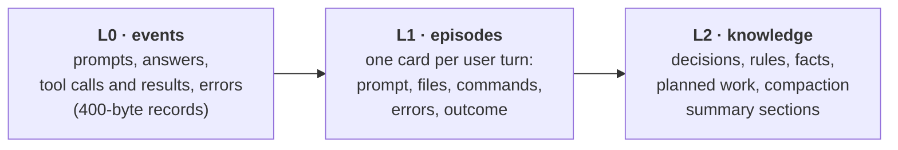
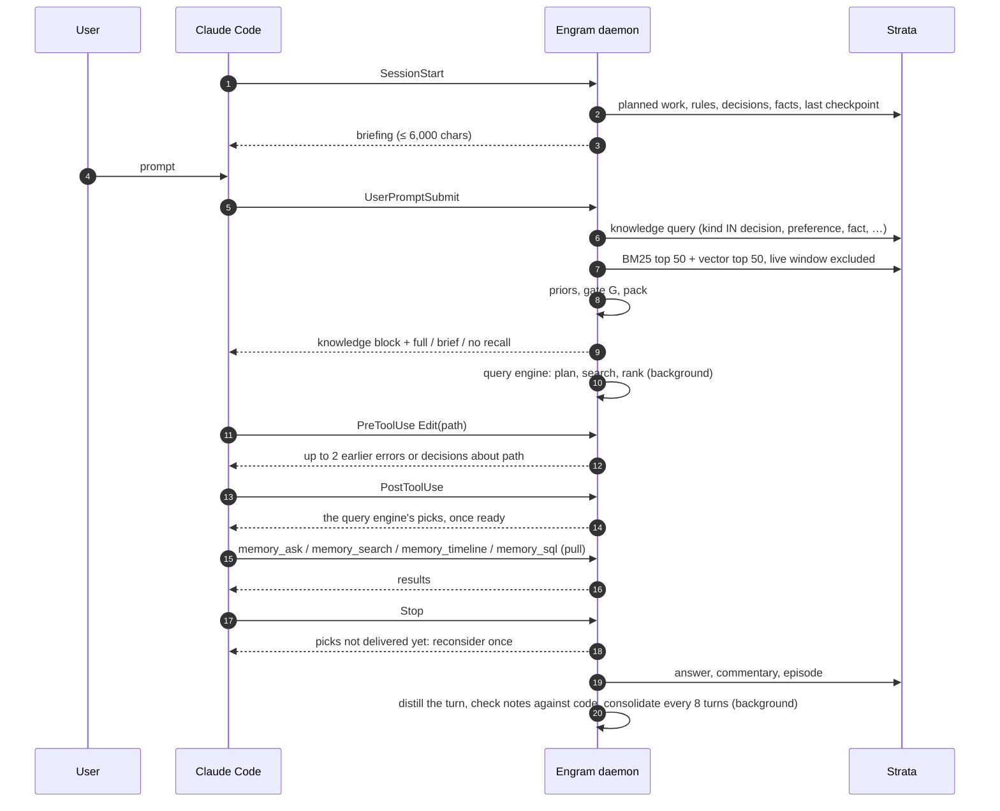
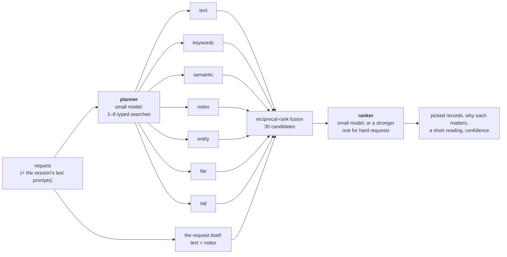

# Engram: how it works
{: .no_toc }

Engram gives a coding agent (Claude Code first) a memory that outlives its context window. It records every prompt, answer, tool call and compaction summary of a project into one Strata file, brings the relevant pieces back at the moments they matter without the model having to ask, and gives the model tools to search its own history when it decides to.
{: .fs-5 .fw-300 }

1. TOC
{:toc}

## The problem

A long session on a complex project outgrows any context window. Claude Code then compacts it into a summary of about 15,000 characters. Summaries keep the plan and lose the particulars:

- exact numbers, error messages and file paths;
- the reason an approach was rejected;
- a preference the user stated once, three hours earlier.

A new session starts with only `CLAUDE.md` and the auto-memory index. The session that built Strata ran for 32 hours and wrote 43.7 MB of transcript across two compactions; its summaries hold under 0.1% of that text.

Three requirements follow:

1. **Store without being asked.** Capture must not depend on the model remembering to save.
2. **Load without being asked, but only when it helps.** Injected context costs tokens and attention, and irrelevant context hurts accuracy. Injection must be gated, budgeted, and must skip what the model can already see.
3. **Let the model ask precisely.** When the model knows it needs history, it gets search, timeline and SQL tools over the same store.

## Architecture


Strata holds an exclusive lock on its file, and hooks are short-lived processes that run concurrently with the MCP server. So one daemon per project owns the database, and hooks and the MCP server are its clients over a Unix socket.

- **Lazy start.** The first client to find no socket spawns the daemon under a spawn lock; the daemon exits after 30 idle minutes. Its first hook takes 50–72 ms, because the 129 MB embedding table is memory-mapped rather than read.
- **Warm state.** The embedder, segment readers and the memtable stay in memory between hooks.
- **Reads in parallel, one writer.** Reads run on each client's own thread against a snapshot, any number at once, and the searches behind one prompt share that snapshot and run side by side while cores are free. Every write goes to one writer thread, which commits whatever is queued in one transaction and builds the new version before the write returns, so a reader never waits for a write or for the index build after it. In-memory chunks hold 256 records and scan their vectors instead of building an HNSW graph, so that build stays cheap.
- **Never in the way.** A client that cannot reach the daemon within its deadline prints nothing and exits 0. A memory failure never blocks a prompt or a tool call.

The store lives outside the repository, in `${ENGRAM_HOME:-~/.local/share/engram}/<project-slug>/`, because transcripts can contain secrets. A redaction pass removes common key and token formats before anything is stored.

## The data model

One Strata table, `memory`. Each record is one key–value pair with attributes.

| field | type | meaning |
|---|---|---|
| `id` | KEYWORD, primary key | `<session-prefix>:<seq>` |
| `session` | KEYWORD | Claude Code session id |
| `kind` | KEYWORD | `prompt`, `answer`, `tool_call`, `tool_result`, `error`, `episode`, `summary`, `decision`, `preference`, `fact`, `todo`, `note` |
| `tag` | KEYWORD | tool name, summary section, `distilled`, `planned`, `superseded`, … |
| `turn`, `seq`, `ts` | INT | user turn, project-wide sequence number, Unix seconds |
| `importance` | FLOAT | salience prior in [0, 1] |
| `files` | TEXT | paths the record touches (path components are terms) |
| `text` | TEXT, stored | the value: one chunk of at most 400 bytes, injected as is |
| `ctx` | TEXT, stored | the turn's request (≤ 200 characters); for notes also the situations they matter in (`When:`) and the code they were written against (`Anchor:`); part of the lexical key, never shown |
| `body` | TEXT, generated from `text` + `ctx` | the lexical key that `bm25` and `MATCH` search |
| `emb` | VECTOR(d), HNSW | the dense key: an embedding of `text` alone (for notes, `text` and its `When:` situations) |
| `links` | EDGES | edges to the turn a record came from, the files it touches (`f:path`) and the entities it is about (`e:name`), which are records of kind `entity` |


Keys are small and precise. A 400-byte window matches a question better than a 1,500-byte chunk in which the answer is one fact among many, and a context budget holds about ten such windows instead of five snippets. The turn's request joins the lexical key, so that a terse tool result ("test result: ok") is found by the words of the task it served; it stays out of the vector, where it would pull every response towards its request. The study behind these choices is in [the results](results.md#what-a-record-should-be).

Records come in three levels:



The kind sets a salience prior ι: preference 1.0, decision 0.9, summary 0.8, prompt 0.7, error and episode 0.6, answer 0.5, tool call and result 0.3.

## When to store: always

Storage is cheap (a durable commit costs about 4 ms on a Mac, where it flushes the drive's write cache, and runs off the hook's path) and a missed record cannot be recovered later.

| hook | stored |
|---|---|
| `SessionStart` | session registered; live window opened |
| `UserPromptSubmit` | `prompt`, plus `preference` records for cue sentences ("always", "never", "from now on", …) |
| `PostToolUse` | `tool_call` and `tool_result` (or `error`), asynchronously |
| `Stop` | the answer, the commentary written between tool calls, the turn's `episode`, then distilled knowledge |
| `PreCompact` | commentary not yet captured |
| `PostCompact` | the summary, by section; the live window restarts here |
| `SessionEnd` | flush |

`engram ingest-transcript` back-fills old sessions from Claude Code's JSONL transcripts.

### Distilled knowledge

Raw records hold what was *said*; a later session needs what was *agreed*: a decision and its reason, a client's rule, the requirements of work announced for later. Much of it never reaches the code, and a request that depends on it rarely sounds like earlier work, so search alone misses it.


After each `Stop`, off the prompt's path, the daemon gives the turn (request, commands, reply) to a small model through `claude -p`, with up to 40 live notes for context: the ones most related to the turn wherever they are in the history, then the newest. Seeing the related ones is what lets the model update a note written weeks ago instead of adding a near-copy next to it. The model returns JSON lines:

| item | stored as | tag |
|---|---|---|
| decision, with the reason | `decision` | `distilled` |
| rule, constraint, convention | `preference` | `distilled` |
| requirement of work planned but not done | `todo` | `planned` |
| fact about the project or its environment, failed approaches | `fact` | `distilled` |
| `replaces: id` | the old item is retagged | `superseded` |
| `done: id` | the planned item is retagged | `done` |

A new item whose analysed terms overlap an existing one by a Jaccard index J ≥ 0.6 is dropped. Distillation costs about **$0.0013 a turn** and 8 s with a small model, and never delays a prompt.

Each note also carries **the situations it will matter in** (`when`), written at the same time: "choosing a library or standard-library module", "parsing a config file" for a note that the client machines run Python 3.8. A later request rarely uses the words of the note it needs; it uses the words of the task. The situations join the note's lexical key and its embedding, so "add a settings.toml loader" finds the Python 3.8 note although they share no word. This is document expansion (doc2query) done once, when the note is written.

### Consolidation

Notes accumulate. Every eight distilled turns (or on `engram consolidate`), the daemon groups live notes that say related things: pairs whose embeddings have a cosine of at least 0.80, or 0.55 when they share an entity, joined strongest first into groups of at most ten. A small model rewrites each group as the smallest set of notes that keeps every detail, number, name and reason that still holds: a later change replaces the earlier version ("30 days, changed from 14"), duplicates merge, notes on different subjects stay apart, and rules, requirements and reasons are never dropped. Each merged note links to the notes it replaces (`supersedes`), which are retagged `superseded` and leave the briefing and recall; a note the model would only reword is kept as it is.

### Notes tied to the code

A note about code goes stale when the code changes. Each note records what it was written against: the commit and branch, a content hash of the files it names or the turn changed (up to six), and the identifiers it mentions (`ROUND_HALF_UP`, `load_config`). When a note is shown (briefing, recall, file notes, the query engine), Engram checks those files in the working tree, reading each once:

| what changed | decision or fact | rule or requirement |
|---|---|---|
| nothing | shown as is | shown as is |
| a file it names, its identifiers still there | "app/billing.py changed since this note; check the current code" | the same |
| the file is gone, or an identifier it names no longer occurs | **may be out of date**: moved to its own briefing section | **the code may now break it**: stays with the rules, with "the code changed since this was stated; check that it still follows it" |

A rule does not go stale because the code moved away from it: a teammate who switched invoices to banker's rounding did not cancel the client's requirement, so the rule stays where the model will see it, with a warning that the code may now break it.

## When to load

Records still inside the model's context are never injected. For each session *s* the daemon keeps the window start w<sub>s</sub>, the sequence number at session start or at the last compaction, and every query excludes

$$
\{\, r : r.\text{session} = s \;\wedge\; r.\text{seq} \ge w_s \,\} \;\cup\; \text{injected}_s
$$

where injected<sub>s</sub> is the set of records already injected since w<sub>s</sub>.


There are three push points and one pull path:



1. **`SessionStart`: a briefing**, always, at most 6,000 characters: planned work with its requirements, rules, decisions, facts, open tasks, and where the previous session stopped, each note checked against the current code. It opens with an instruction to search memory before a design decision. After a compaction it also recalls the records most relevant to the last two prompts.
2. **`UserPromptSubmit`: knowledge, then gated recall.** Up to four knowledge records not yet shown that match the prompt on their own text, bypassing the gate:

   $$
   \cos\bigl(\phi(q), \phi(r)\bigr) \ge 0.40 \;\lor\; \mathrm{cov}(q, r) \ge 0.30,
   \qquad \mathrm{cov}(q, r) = \frac{\sum_{t \in q \cap r} \mathrm{idf}(t)}{\sum_{t \in q} \mathrm{idf}(t)}
   $$

   Then the main search and a three-way gate: strong evidence injects the top records up to 4,000 characters; weak evidence injects three records up to 1,200, marked as a weak match; otherwise nothing.
3. **`PreToolUse` on `Edit`/`Write`: file notes.** Up to two older errors, decisions or rules anchored to that path, once per file per window.
4. **Pull: MCP tools.** `memory_ask` (the query engine below), `memory_search`, `memory_timeline` (the neighbourhood of a hit), `memory_sql` (read-only SQL over `memory`), `memory_remember` and `memory_forget`.

The briefing also ends with a one-line index of the notes it had no room for ("31 older notes are not shown here, about: …"), so the model knows what to ask for.

### Ranking

BM25 and vector search each return their top *n* = 50 under the exclusion filter. Scores are min-max normalised over the union *C*, a missing score counting as 0:

$$
\mathrm{rel}(r) = w\,\widehat{\mathrm{bm25}}(r) + (1 - w)\,\widehat{\cos}(r)
$$

Priors then break near-ties without overriding relevance, with ι the salience prior and τ a recency scale:

$$
S(r) = \mathrm{rel}(r)\,\bigl(1 + \lambda_\iota\,\iota(r)\bigr) + \lambda_t\, e^{-(\mathrm{seq}_{\max} - \mathrm{seq}(r))/\tau}
$$

Answers that admitted not knowing and repeats of the same question are excluded, because they would only replay a failure. Packing is greedy by *S*: at most twelve records, at most eight per user turn. Every injected line carries its provenance (kind, session, turn, relative time and id), and up to five further candidates follow as one line each for the model to open with `memory_timeline`.

### The gate

Min-max scores cannot gate, since the best candidate always scores 1. The gate uses absolute evidence about the best candidates: the highest cosine and term coverage among the top five, how far the best BM25 and cosine scores stand above the tenth, whether BM25 and vectors agree on the top record, and whether the prompt refers back ("earlier", "we decided", "last time", …):

$$
G = a\,\cos_{\max} + b\,\mathrm{cov}_{\max} + c\,\mathbb{1}_{\text{cue}} + d\,\mathbb{1}_{\text{agree}} + e\,(\cos_1 - \cos_{10}) + f\,\Bigl(1 - \frac{\mathrm{bm25}_{10}}{\mathrm{bm25}_1}\Bigr)
$$


The weights come from a logistic fit on LongMemEval-S (`engram/scripts/fit_gate.py`): positives are questions whose evidence the packed injection contains; negatives are questions asked against another conversation's store, abstentions and misses. θ<sub>hi</sub> holds precision 0.9 on the fit and θ<sub>lo</sub> precision 0.7. The gate is the weakest part of the design; [the results](results.md#the-gate) say why.


## Query understanding

One search, however good its ranking, cannot answer "where does an unknown product code get caught, and why do we raise instead of skipping the line?". The answer is spread over a file, a decision and the error that led to it, and each is found by different words. The query engine turns a request into several searches, runs them all, and has a model pick what answers it.



1. **Plan.** The planner sees the request, the session's two previous prompts, the store's size and time span, and the names of the entities and files notes are about. It writes up to eight searches, several of one type if that helps, covering each part of a question and the constraints a task touches without naming them (the machines it runs on, file formats, earlier failed attempts). It also says whether memory can matter at all, and whether the request is hard.
2. **Search.** Every search runs in parallel, plus two on the request itself, each with the live-window exclusion:

   | type | runs |
   |---|---|
   | `text` | the hybrid search above (BM25 and vectors) |
   | `keywords` | BM25 alone: identifiers, error text |
   | `semantic` | vectors alone, with a sentence phrased like the record hoped for |
   | `notes` | decisions, rules, requirements and facts only |
   | `entity` | records linked to named entities (matched by id, stem or embedding), two hops through the graph |
   | `file` | records about a path (`MATCH(files, …)`) |
   | `sql` | a `WHERE` and `ORDER BY` over `memory`, checked to be a single condition |

3. **Fuse.** Lists are merged by reciprocal rank, Σ 1/(61 + rank), so a record found by several searches comes first; the best 30 go on.
4. **Rank.** The ranker reads the 30 (600 characters each, with kind, date and any staleness label) and picks at most eight, each with why it matters, plus a one-to-three sentence reading that cites ids, and a confidence. Only picks the session has not seen are shown.

It runs in one of four modes (`"deep": {"mode": …}` in the store's `config.json`, or `ENGRAM_DEEP`):

| mode | when it runs | how its result arrives |
|---|---|---|
| `off` | never | |
| `tool` | only when the model calls `memory_ask` (or `engram ask`) | the tool's result |
| `async` (default) | after every prompt of four words or more, once the store holds 20 records, in the background | with the next tool result; if the turn ends first, its end waits up to 25 s and, when the picks are new and the ranker's confidence is high or medium, asks the model once to reconsider and give its whole answer again |
| `sync` | the same prompts, before the model starts | in the prompt's context, after a wait (12 s at the median and 16 s at p90 in the cloud container, six requests at a time) |

Both model calls go through `claude -p` with no tools and no prompt caching (each prompt is new, so a cache write would cost more than it saves), like distillation, and together read about 5,800 tokens and write 1,150: $0.0012 a request with a small model ($0.58 for 500 LongMemEval questions).

Two settings make it cheaper. `"planner": "none"` (`ENGRAM_DEEP_PLAN=none`) skips the planning call: the ranker reads the best 30 of the request's own two searches, taken deeper. `"ranker": "local"` (`ENGRAM_DEEP_RANK=local`) replaces the ranking call with a logistic model over twelve features of each candidate (fused rank, similarity, term coverage, kind, length, recency) and keeps the top 5, with no model call; with `planner` also `none` the engine is free. On LongMemEval the default answers best: ranker only loses temporal questions, and the local ranker keeps about a quarter of the gain ([results](results.md#the-query-engine)). The models are parameters: `planner_model` and `ranker_model` (default `haiku`, or `ENGRAM_DEEP_MODEL` for both), and `hard_model`, a stronger ranker used only when the planner calls a request hard (`ENGRAM_DEEP_HARD_MODEL`). `memory_ask` also takes a `model` for one question, so a user who allows a more expensive model can have it for the questions that need it.

## Cost and latency targets

| path | target | measured |
|---|---|---|
| `PostToolUse`, `Stop` client | < 10 ms | queued; embedded and committed in the background |
| `UserPromptSubmit` | < 100 ms p99 at 1M records | 24.9 ms p50, 38.6 ms p99 as a hook process |
| `SessionStart` | < 150 ms (daemon up), < 1 s with spawn | 50–72 ms including daemon start |
| ingest | > 1,000 records/s | 48,000–52,000 records/s with the static embedder |
| query engine (planner and ranker) | off the prompt's path unless `sync` | 12 s p50, 16 s p90, $0.0012 per request with Haiku |

The default embedder is static (Model2Vec potion-retrieval-32M: token lookup and mean, 512 dimensions, microseconds per record). BGE-small (384 dimensions) is optional (`--features bert`) and costs about 50 ms per record on a CPU.

## Install and use

[Install on your machine](setup.md) has the whole procedure, remote machines and dev containers included. In short:

```sh
git clone https://github.com/rkonow/engram && cd engram && ./install.sh   # every Claude Code session
./install.sh --project /path/to/your/project                              # or one project
engram doctor                                                             # check the setup
engram ui                                                                 # browse what it stored
```

```sh
engram ask "where do invoice totals get rounded, and why that rounding mode?"   # the query engine
engram ask --model sonnet "..."                                                  # with a stronger model
engram search "why did the planner pick post-filtering"
engram sql "SELECT ts, text FROM memory WHERE kind = 'error' AND MATCH(files, 'exec') ORDER BY ts DESC LIMIT 5"
engram remember decision "Prices are integer cents"
engram ingest-transcript ~/.claude/projects/<project>/<session>.jsonl   # back-fill old sessions
engram distill                                                          # distill turns stored before distillation existed
engram consolidate                                                      # merge overlapping notes now
engram stats | briefing | stop
```

| variable | effect |
|---|---|
| `ENGRAM_DISABLE=1` | turns the hooks off |
| `ENGRAM_HOME`, `ENGRAM_MODELS` | relocate the store and the models |
| `ENGRAM_DISTILL=0` | turns distillation off (or `"distill": {"enabled": false}` in the store's `config.json`) |
| `ENGRAM_DISTILL_MODEL` | the model the distiller and consolidation use |
| `ENGRAM_DEEP` | query engine mode: `off`, `tool`, `async` (default), `sync` |
| `ENGRAM_DEEP_MODEL`, `ENGRAM_DEEP_PLANNER_MODEL`, `ENGRAM_DEEP_RANKER_MODEL`, `ENGRAM_DEEP_HARD_MODEL` | the query engine's models (default `haiku`; the hard model is unset) |
| `ENGRAM_DEEP_PLAN`, `ENGRAM_DEEP_RANK` | `none` skips the planner; `local` ranks without a model call (defaults: `model`, `model`) |
| `ENGRAM_CONSOLIDATE=0` | turns consolidation off |
| `ENGRAM_EMBEDDER` | `static` (default), `bert`, or `hash:<dim>` for a model-free hash embedder |

The full design, including the evaluation plan, is in [`engram/DESIGN.md`](https://github.com/rkonow/engram/blob/main/engram/DESIGN.md).
