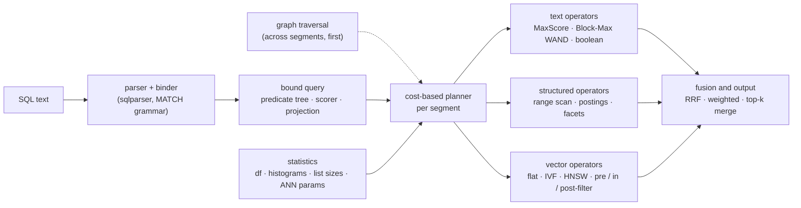
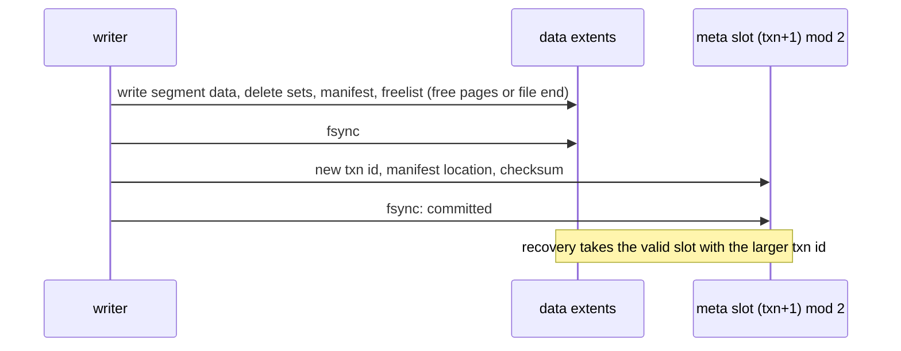

# Strata: design
{: .no_toc }

Strata is to search what SQLite is to relational data: a library that keeps a whole database in one file, needs no server or configuration, gives ACID transactions, and is queried with SQL. Every table is indexed three ways at once (posting lists, a columnar forward index and vector indexes), rows can hold graph edges to other rows, and a cost-based planner combines all of it in one statement.
{: .fs-5 .fw-300 }

1. TOC
{:toc}

## Goals

- **Embedded and single-file.** One `.strata` file plus a `-wal` sidecar, like SQLite in WAL mode. Opening a database maps the file and loads nothing eagerly, so databases larger than RAM work and a cold open costs the same whatever the size.
- **ACID with snapshot isolation.** One writer, any number of readers. Readers never block and always see a consistent snapshot; a crash at any point leaves the last committed state.
- **SQL with search extensions.** `SELECT … WHERE … ORDER BY … LIMIT`, `GROUP BY` for facets, plus `MATCH` (boolean full text), `bm25()`, `similarity()` and `distance()` (vectors and learned sparse weights), `rrf()`, weighted sums and products (fusion and boosts), `decay()` (closeness to a value or a time) and graph traversal, and `INSERT`, `UPDATE` and `DELETE`. The [query language](query-language.md) page is the reference.
- **Three index families, freely combined.** Full text (BM25, boolean and phrase queries), structured fields (equality, `IN`, ranges, facets) and vectors (approximate and exact nearest neighbours), in any combination: filtered vector search, filtered BM25, hybrid ranking, facets over any result.
- **Graphs over the same rows.** A row can hold typed, weighted edges to other rows. Traversals, shortest paths and personalized PageRank run in the same statement as everything else ([Graphs](graphs.md)).
- **Disk-aware.** Every structure is read in place through `mmap`, with no deserialisation, and laid out so that a query's I/O is proportional to its work.

Multiple writer processes are out of scope for the prototype. Joins across tables, and sharding and replication in [strata-server](server.md), came later; [current limits](#where-it-fits) has where they stand.

## Architecture

A statement goes through four stages. The binder turns SQL into a predicate tree and a scorer; the planner picks, per segment and from exact statistics, how to evaluate each part; operators run against zero-copy views of the segment's sections; per-segment results are merged.

## Storage engine

### Immutable segments, not a B-tree

SQLite updates B-trees in place. Compressed posting lists, bit-packed columns and vector graphs do not survive that: inserting one docID into a compressed partition means re-encoding it, and the best encodings are chosen per whole list. SQLite's own FTS5 already stores its index as immutable segments merged in the background, as do Lucene, Tantivy and PISA. Strata uses that log-structured design for the whole table: every index lives in immutable segments, writes go to a WAL and an in-memory memtable, and segments are merged in the background.

### One file

Pages are 4 KiB. Pages 0 and 1 are two meta slots (magic, format version, transaction id, manifest and freelist locations, page count, CRC32); the rest are extents, runs of pages holding segment data, manifests, delete sets and freelists. Segments are written once, never modified, and freed only when no snapshot references them.

The file is read through one `mmap`. Sections read at random positions (the HNSW graph and its codes, float32 vectors for re-ranking, dictionaries, the doc store, the key index) are advised `MADV_RANDOM`, so a cold page fault reads one page instead of the kernel's read-around of up to 32. Sections read a run at a time (postings, document lengths, columns, IVF clusters) keep read-ahead. Readers open lazily per field, so a query touches only the headers of the fields it uses.

### Commits by shadow paging

A torn meta write fails its checksum and the other slot still names the previous, fully written state. Nothing reachable from a valid meta slot is ever overwritten (the LMDB discipline), so there is no rollback journal. The same holds when the newest version itself is damaged (its manifest or free list fails its checksum, or a segment it names does not open, as a power loss with `sync` off can leave it): opening falls back to the version in the other slot, says so in `Database::damaged`, and the next commit overwrites the damaged slot. Whatever `sync` is, a version's pages are synced before its meta slot names them, and so is the WAL before it, so that the version to fall back to is always whole and no transaction outlives one it came after. The meta slot is synced last, since the next commit overwrites the other one. Without `sync`, then, a power loss loses the transactions since the last flush, newest first, and nothing else.

A new database is written under a hidden name beside its path (`.<name>.creating-…`), then linked (a file) or renamed (a directory) to its name whole, so a crash while it is created leaves a database there or nothing, and the path can be created again.

Every manifest, free list, delete set and segment has a CRC32, and so does each section of a segment (a field's postings, positions or column, the doc store, the keys). Opening checks the meta slots, the manifest, the free list and every delete set and update file, but not whole segments, which would read the entire database at each start. Instead a query checks each section of a segment against its CRC32 the first time it reads that section, which reads the whole section once, and fails rather than answer from damaged bytes, while queries that read other sections go on (`DbOptions::check_sections`, on by default; the keys are checked as the segment opens, and segments written before sections had a CRC32 are not checked this way). While it checks a section the kernel may read ahead in it, even in one advised to be read at random. On a database of 1,000,000 documents (687 MB: text with positions, 64-dimensional HNSW vectors), with the file in the page cache, opening took 4 ms more, the first text query 13 to 17 ms more and the first vector query 41 to 49 ms more; with it evicted, opening took 14 ms more and the first text query 45 to 275 ms more, while the first vector query was no slower, since reading its sections in long runs saves the search's page-at-a-time reads; later queries cost the same ([results](https://github.com/rkonow/strata/tree/main/strata/results/section-checks), three rounds on the cloud container). A reader also checks the structure of the segment data it uses: offsets and lengths against the section that holds them, a posting list's partitions against the list's length and docID range, and the whole of a long text posting list (512 postings or more: its docIDs in order, its encodings consistent) the first time a query reads it, so a damaged segment cannot make Strata read outside the file. A query that reaches damage these checks let through can still fail with a panic (strata-server answers 500 and goes on). A merge checks every segment it reads against its checksum first, so that damage is never copied into a new segment under a fresh checksum, and `DbOptions::verify_checksums` (strata-server's `--verify-checksums`) checks them all at open, where a damaged segment in the newest version means falling back to the version before. Replay also checks each WAL operation against its table's schema and treats one that could not have been committed as damage, like a failed checksum. The fuzz targets in `strata/fuzz` (cargo fuzz) feed the engine damaged posting lists, segments, WALs, manifests and free lists, and arbitrary SQL; `strata/tests/corrupt_input.rs` runs the same targets on a few thousand inputs in CI. `strata/tests/sql_oracles.rs` checks SQL's answers with SQLancer's oracles (Rigger and Su), which need no second engine: a random condition splits a table into the rows where it is true, false and unknown, and rows, counts, sums, minimums, maximums, groups, `DISTINCT` values and `HAVING` over the whole table must be those of the three parts combined (ternary logic partitioning); the same condition counted, returned, and run over a derived table, which filters and groups in memory, must agree (NoREC); pages must be slices of the whole order; and two or three shards must answer as one database, over rows in segments and the memtable, deleted and updated rows and multi-valued columns (`STRATA_SQL_ORACLE_RUNS` scales the number of queries). Miri runs in CI too, over the zero-copy byte views that every index reads its data through and the posting lists, columns and keys read through them, checking each access for undefined behaviour (it found views of `Vec<u8>` buffers that relied on the allocator for their 8-byte alignment; such bytes are now copied to an aligned start).

A test layer (`storage::io`, feature `fault-injection`) records every write, truncation and sync, and builds what a power loss at any call could leave of each file, sector by sector, or makes a call fail as a full or failing disk would (a failed sync loses the unsynced writes, as Linux does). `tests/storage_faults.rs` runs a workload of transactions, flushes, merges, vacuums and bulk loads with each of its several hundred calls failing in turn and checks the reopened database; CI runs it on Linux and macOS. `tests/storage_model.rs` checks the storage API against a model of every row: random transactions on two tables (inserts, upserts, conditional upserts, deletes, values set and added in place, rollbacks), SQL writes, flushes, merges, vacuums, bulk loads and reopens, in both layouts, with the rows, key lookups and eight queries (ranges, keywords, text, floats, NULLs, a NOT, a count and a top-k) compared after each step, and every pinned snapshot still returning the rows of its moment (`STRATA_MODEL_SEEDS=100` runs more seeds than CI's eight).

### WAL, memtable and snapshots

Small transactions would otherwise write a segment each. Instead, inserts and deletes append checksummed records to the `-wal` sidecar and `fsync` at commit (group commit); recovery ignores uncommitted records. Replay stops at the first damaged record and cuts the log there, after copying it to `-wal.damaged` if commits follow the damage. With `sync`, more than one commit after the damage means the log was damaged after it was durable, not torn by a crash during the last append, and opening fails unless `DbOptions::wal_drop_damaged` (strata-server's `--wal-drop-damaged`) says to drop them. The memtable holds the WAL's documents. A snapshot that needs them builds small in-memory segments, one per chunk of 1,024 documents, cached so that a write rebuilds only the last chunk. Queries therefore see committed writes at once, and the memtable needs no index code of its own. With `publish_snapshots` on (Engram turns it on), the writer builds that chunk before the commit returns and readers only take the finished snapshot, so no reader builds one or waits for another reader's build. When it grows past a threshold it is flushed into a segment by a shadow-paging commit and the WAL is truncated. With a flusher thread (`Database::spawn_flusher`; strata-server starts one) the commit that fills the memtable does not wait for that: the flusher seals the memtable and the WAL (renamed to `-wal.<txn>`, with commits going on in a new one), builds the segments while writes go on, and installs them in a commit that carries over what those writes deleted or set in place in the sealed documents, keeps the rest in the memtable, and deletes the sealed log. Opening replays a sealed log no flush installed before the open one. The flusher holds the writer lock only to seal and to install, and writes that start meanwhile wait for it instead of failing with `Busy`. Once the memtable holds twice its threshold, new writes wait for the flush under way, so they go at the pace of flushes. A commit that returns `Ok` is durable and one that returns an error wrote nothing, so a failed commit can be retried: a flush that fails after the WAL append (a full disk, say) does not fail the commit, shows in `Database::flush_error`, and is tried again by the next commit, and writes are refused before they reach the WAL once the memtable holds twice its threshold while flushes still fail. Bulk loads bypass the WAL. A database can also number its writes, the order replication ships them in (`Database::start_seq_no`, which cannot be undone): each write transaction gets the next sequence number under the database's term (`Database::begin_term` raises it when a replica becomes primary), logged in its commit record and kept across flushes, crashes, checkpoints and reopening. Its WAL then starts `STRWAL02`, with a header naming the features its records use, and the database needs feature `seq_no`, so older versions refuse it rather than lose the numbers; other databases log as before. Each row of a numbered database keeps the number of the write that last changed it (`Database::seq_of`), in its segment and beside values set in place; rows written before numbering, bulk loaded or attached have number 0. With `DbOptions::ship_log_bytes` it also keeps its latest transactions as it logged them, which `Database::log_from` reads for a replica and `Database::apply_shipped` applies on one, under the primary's numbers, after checking that they follow the replica's last transaction and come from its term or a newer one. A replica that the log no longer reaches installs a checkpoint of the primary instead, in one commit (`Database::install_copy`). strata-server ships them from a primary to its replicas, and sends a replica too far behind a copy ([replication](server.md#replication-a-primary-and-its-replicas)). A snapshot says the last transaction it holds (`Snapshot::seq_no`), so a read can wait on a replica for a version that holds a given write ([reads that see a write](server.md#reads-that-see-a-write)), and lists each live row's key and number (`Snapshot::row_versions`), which a primary and its replicas compare by digests ([comparing copies](server.md#replication-a-primary-and-its-replicas)). A replica is made the primary of a new term by hand, which fences the old primary ([promotion](server.md#replication-a-primary-and-its-replicas)).

Every document has a primary key. Each segment has a primary-key index (sorted 64-bit key hashes with docIDs) and a delete set, stored as its own small extent and replaced copy-on-write. An update is a delete plus an insert. A snapshot is an immutable manifest version (segments, their delete sets, collection statistics) held by reference count: readers pin one, the writer publishes the next. Taking one costs at most 0.13 µs.

A database can hold several tables, each with its own schema, segments, memtable and merges, under one WAL, one writer and one manifest: a transaction can write several tables at once, and a snapshot sees all of them at the same version. SQL creates and drops tables (`CREATE TABLE`, `DROP TABLE`), and each statement reads or writes the table it names.

Format 3 is the last format number: its manifest lists the features the database uses (field ids, `BOOL` and `TIMESTAMP` columns, `NOT NULL` and `DEFAULT`, a text analyzer other than `english`, `MEDIA` fields, numbered writes, rank profiles), and a later change adds a feature instead of a number. A version of Strata refuses a database that needs a feature it does not have, and says which. Every field has an id, which names it on disk: in its segments' section names, their stored rows and the values set in place, and in a list of ids each segment keeps, which `check` compares with the manifest. The manifest keeps each table's ids and the next one to give (feature `field_ids`), so a field is never read by its position or its name. It is the ground for changing a table's fields without rewriting its segments.

Every database this version creates has field ids. One written before them named its fields by position and name, in format 1 (one table), 2 (several) or 3; this version refuses to open it and says how to copy it: `strata::upgrade::upgrade(path)` (`strata-server upgrade PATH`, `strata.upgrade(path)` in Python) writes a new database beside it with the same tables, rows, vectors and rank profiles, in the same layout, puts it in its place and keeps the old one as `<path>.before-field-ids`. A crash during the copy leaves the old database where it was, and one between the two renames is finished by the next call. Engram copies each of its stores the first time it opens it. A database that numbers its writes (replication) or keeps stream offsets is not copied, since its copy could not go on from their numbers: create a new one and fill it with `Db::load_from`. Databases that earlier versions wrote, in both layouts, are kept in the repository (`strata/tests/fixtures`): every later version's tests check that it refuses them, opens them to be copied, copies them, and writes the sets of this version byte for byte.

### Merges

A tiered policy merges segments of similar size. A merge reads the live documents of its inputs back (stored fields from the doc store, vectors and unstored fields from their indexes, generated columns recomputed) and rebuilds every index, which drops deleted documents and re-optimises encodings for the longer lists. An HNSW graph starts from the graph of the largest input that lost no documents, as Lucene's does from 9.9: that input's nodes keep their levels and links, and only the other inputs' vectors are inserted. Building the merged segment of four segments of 25,000 vectors so takes 5.2 s instead of 6.9 to 7.2 s on four threads at 64 dimensions (24.2 to 24.7 s instead of 30.1 to 32.2 s on one), and 9.1 to 9.3 s instead of 11.9 to 12.2 s at 256, with the same recall@10 (two runs each on the cloud container's 4-core Xeon, `examples/graph_start.rs`). `vacuum` moves data down and shrinks the file.

A merge does not hold all its inputs' documents at once. It decodes them in batches of about 32 MB of input image (16,384 to 262,144 documents, a batch spanning inputs), and the segment builder takes each batch as it comes: what has to see every document before it can be written (a TEXT field's posting runs, the primary keys) is kept from earlier batches in compact form (runs packed as varints, keys in one buffer), while another thread decodes the next batch. The merged image is then streamed into its reserved space a megabyte at a time, checksummed on the way, rather than assembled in memory first. It is the same bytes as a build of all the documents at once. Merging four segments of 400,000 short texts (225 MB of image) so peaks at 2.6 times the input on one thread and 3.5 to 3.8 on four, instead of 4.3 and 5.2 to 5.4; four of 40,000 long texts (376 MB) at 1.9 and 2.5 instead of 3.9 and 5.0, in 17.5 to 17.6 s instead of 22.6 to 22.9 s on one thread and 7.7 to 7.8 s instead of 10.9 to 11.3 s on four; and four of 150,000 texts with 64-dim vectors (443 MB) at 1.7 and 2.3 instead of 2.7 and 3.3 to 3.6. A merge that fits in one or two batches takes about what it did (two runs each on the cloud container's 4-core Xeon, `examples/merge_memory.rs`).

Merges stay out of the way of writes. A merge builds its segment with no lock held, then reserves a segment id and space for the image (free pages of the file, or a file of its own in the directory layout) and writes it there, also with no lock held. It takes the writer lock only to install the image, in a commit that marks the input documents deleted since it started as deleted in the merged segment; writes that start meanwhile wait for it instead of failing with `Busy`. Until the install, commits leave the reserved space alone and the free list on disk counts it as free, so a crash leaves nothing behind. Several merges can run at once, each on segments no other merge has claimed. With merger threads (`Database::spawn_merger`; strata-server starts them) the database merges by itself whenever a version is published and every 5 s:

- up to `threads` merges at once (default: half the cores, 1 to 4);
- within a memory budget, by default a quarter of the process's cgroup memory limit or of the machine's RAM. A merge is estimated from the image bytes of its inputs' live documents: 5.5 + 0.5 × its build threads times the bytes of its first four batches (decoded documents, the builder's structures and the merged sections; measured up to 4.0 times on one thread, 6.6 on four and 8.2 on eight, in merges of short texts small enough to fit one batch), plus 2 + 0.25 × its build threads times each byte after them (measured up to 1.8 on one thread and 2.1 on four, in merges of long texts and of texts with vectors). Merging four segments of 100,000 long texts (919 MB) on four threads is so estimated at 3.7 times its input, against 2.2 measured (merges of 15 to 937 MB of short texts, long texts and texts with 64- and 384-dim vectors on the cloud container's 4-core Xeon, `examples/merge_memory.rs`). One that does not fit is cut to its smallest inputs, or waits for running merges to finish;
- writing no faster than `write_bytes_per_sec`, if set.

The merges running are recorded in a file beside the database (`<file>-merging`, or `MERGING` in the directory). If the process dies during one (killed for running out of memory, typically), opening finds it in the record, and the segments it was merging are then merged only in groups estimated at under half its memory, halving again at each interruption, and are left alone once no group of them fits, rather than restarting into the same merge. `Database::merge_status` reports the merges running, their memory, the budget, the merges cut to fit and the interrupted ones.

## Segments

A segment is *n* documents with local docIDs `0..n`, stored as a header and a directory of named sections (`text.body.terms`, `text.body.post`, `col.year`, `vec.emb.ivf`, …), each with its offset, length and CRC32. Sections are 64-byte aligned, and those over a page are page-aligned, so any `&[u64]` view of a section is aligned and an index can be used straight from the mapped file. Each index component has a builder (documents in docID order to section bytes) and a reader (sections to a zero-copy view). A build of 1,024 documents or more runs on several threads (build option `build.threads`, by default the cores, at most 8): the fields build at once, longest first; a TEXT field's documents are analysed in runs, one per thread, and its posting lists are then encoded in ranges of terms, one per thread. The image is the same bytes as a build on one thread, and as a build that takes the documents in batches (`SegmentBuild`, which merges use). On TREC-COVID (171,332 documents, 192 MB of text), a text segment builds in 2.9 to 3.2 s on four threads and 9.0 to 9.7 s on one (two runs each on the cloud container's 4-core Xeon). An HNSW graph uses threads of its own (`vector.threads`, default 1; strata-server sets the cores), whose inserts race, so its links vary slightly from build to build. Operators run per segment and their results are merged; collection-wide statistics keep BM25 scores comparable across segments.

## Index families

### Full text

- **Analyzer.** Unicode word split, lowercase, ASCII folding, an English stopword list and a light English stemmer (words longer than 64 bytes are kept whole: the stemmer takes time in the square of a word's length): `english`, every TEXT field's unless its schema names `simple`, which keeps every word as written (for names, codes and other languages). A field's queries use its analyzer, and the schema records it by name and version, so a version of Strata whose analysis differs refuses the field instead of misreading it.
- **Term dictionary.** Sorted terms in front-coded blocks of 32, with a sparse in-memory index over block first-terms. Each entry gives the document frequency and the posting list's location.
- **Postings.** DocIDs, term frequencies and per-block maximum scores, so that top-k can skip blocks. DocIDs of terms in at least 512 documents are [Loom](../posting-lists.md#loom) lists; rarer terms use BP128 blocks. Frequencies are bit-packed in 128-posting blocks addressed by posting rank. Against BP128 for every list, Loom is 2–4% smaller with 7.6–11× faster conjunctions.
- **Top-k.** MaxScore by default; on the BEIR queries it beats Block-Max WAND by 1.9–2.6×. A filter either drives scoring (its members are scored directly) or is probed per candidate, by a fitted crossover.
- **Positions** (optional per field) live in a separate stream, read only by phrase queries.
- **Learned sparse fields.** A `SPARSE` field holds a weight per term, as SPLADE or BGE-M3's sparse head produce, in the same kind of inverted index with the weights quantised into the frequency slot. `similarity(field, :q)` ranks by the dot product with the query's weights through the same MaxScore and Block-Max WAND, block bounds and filter strategies as BM25.

Scores are BM25 with *k*1 = 1.2, *b* = 0.75 and Lucene's idf, over statistics summed across the snapshot's segments, so a document scores the same in any segment:

$$
\mathrm{bm25}(d, q) = \sum_{t \in q} \mathrm{idf}(t)\,\frac{\mathrm{tf}_{t,d}\,(k_1 + 1)}{\mathrm{tf}_{t,d} + k_1\bigl(1 - b + b\,\lvert d \rvert / \mathrm{avgdl}\bigr)},
\qquad
\mathrm{idf}(t) = \ln\Bigl(1 + \frac{N - \mathrm{df}_t + 0.5}{\mathrm{df}_t + 0.5}\Bigr)
$$

*N* and avgdl count the documents with at least one term in the field, as Lucene's `docCount` does, so rows without a value do not shrink the average length. Document lengths are quantised to one byte. Ranked queries drop English function words, and a term written twice weighs twice.

A relevance gate in CI holds the ranking still: BM25 through SQL on the test splits of SciFact, NFCorpus and ArguAna (plain, and with `fuzzy => 'auto'` on the first two) must keep nDCG@10, recall@100 and recall@1000 within 0.002 of the numbers in `strata/tests/fixtures/relevance_gate.json`. A change that moves them fails until the pull request that makes it commits the new numbers, which the test writes (`STRATA_RELEVANCE_GATE=update`); the failure gives a paired randomization p-value over the queries. Settings are tuned on the dev or train splits (`strata-bm25-eval --split dev`), and the hybrid study picks its fusion weight on half of the queries and reports the other half.

### Structured fields

- **Columns.** Integers and floats in 128-document blocks, frame-of-reference bit-packed, with min/max zone maps per block. Keywords are dictionary encoded with bit-packed codes. A column answers "value of document *d*" in O(1) and scans at memory bandwidth.
- **Keyword postings.** Every keyword value also gets a docID list, so equality and `IN` become set operations. The encoding is [Pyramid](../posting-lists.md#pyramid) (plain sorted arrays below 64 documents), which has the fastest unions and count-only intersections for facet counts. Per-candidate probes use the code column and a bitset of accepted codes (4–5 ns), which beats probing the lists (5–33 ns).
- **Range postings.** Numeric fields get an equi-depth histogram of 64 buckets whose buckets are docID lists. A range is the union of the buckets it covers, plus the boundary buckets filtered through the column. The histogram doubles as the selectivity estimator.
- **Doc store.** Rows in LZ4-compressed 16 KiB blocks with a block index; it serves projections and is the source for merges.
- **Generated columns.** A TEXT field may be generated from other stored text fields (`body` = title + text in the evaluation table), indexed but not stored, and recomputed by merges. Any other indexed TEXT or SPARSE field must be stored, since a merge rebuilds its index from the stored values: a schema refuses one that is not, and a merge of a database created before that check fails rather than empty the index.
- **Loading files.** `strata::ingest` reads rows from JSON Lines, JSON and CSV or TSV files against the schema, and `ingest::import` bulk-loads them into an empty table in one commit (a bad row writes nothing) or upserts them in batches; `strata-server import`, the server's `POST /v1/import` and Python's `import_file` use it ([loading rows](server.md#loading-rows)). `Schema::from_json` reads a schema in a short form, types by name and only the options that differ from the defaults ([schemas](server.md#schemas)).
- **Embedded vector fields.** A VECTOR field may be declared as a model's embedding of other fields (`"embed": {"from": ["title"], "model": "potion-retrieval-32M"}`). The schema records it; given the model, writes that leave the vector out get it computed and rewrites of a source recompute it (a SQL write computes them before it takes the writer lock, so other writes do not wait for the model), while merges keep the stored vectors ([embedded vector fields](server.md#embedded-vector-fields)).

### Vectors

- **Forward vectors.** Every vector field stores float32 vectors for exact re-ranking and 8-bit scalar-quantised codes (SQ8, per-dimension min/max) for scanning: 4× less I/O, and with the query quantised too, integer dot products at about 14 ns per 1,024-dimension vector with NEON `usdot` on the M2 (AVX-512 VNNI on x86-64). A field can keep 1-bit codes instead (`"codes": "binary"`), an eighth of the memory, with 8 times as many candidates re-ranked ([results](results.md#compressed-vectors)).
- **Flat.** An exact scan of the codes plus float32 re-ranking: the right answer for small segments and very selective filters.
- **IVF.** k-means centroids; each cluster's members are stored contiguously as a docID list followed by their codes. Probing a cluster is one sequential read, and a filter is applied by intersecting the cluster's list with the filter's, the same operation as a text conjunction.
- **HNSW.** A navigable small-world graph with fixed-degree adjacency lists in the segment. Fastest in memory; random I/O on disk.

### Graph edges

An `EDGES` field holds a row's outgoing edges as targets' primary keys, optionally with a label and a weight. Per segment, Strata stores the out-edges as a CSR over local docIDs and a reverse index grouped by target key; a hop resolves keys against the snapshot's primary-key indexes. Because edges point at keys and not at storage positions, they survive updates, deletes and merges untouched. The [Graphs](graphs.md) page covers the layout, the traversals and their cost.

## Planning and execution

The binder turns `WHERE` into a predicate tree over text leaves (`MATCH`), structured leaves (comparisons, `IN`, ranges) and graph leaves (`REACHABLE`, `PATH`), and turns `ORDER BY` into a scorer: BM25, vector, fusion, PageRank, a column, or none.

**Statistics.** Exact list lengths (document frequencies, keyword list sizes), histogram bucket counts, per-segment document counts and ANN parameters. Conjunctions assume independence; disjunctions use inclusion–exclusion.

**Filters: materialise or probe.** A predicate is either *materialised* (a docID set from postings) or *probed* (a per-candidate check against the forward column). Materialising costs work proportional to the lists; probing costs work proportional to the candidates. The planner materialises when the candidate stream is long relative to the lists and probes otherwise. Range filters also choose between a zone-map column scan and histogram bucket postings.

**Ranked retrieval.**

| `ORDER BY` | strategies |
|---|---|
| none or a column | iterate the filter; top-k heap or column sort |
| `bm25` | MaxScore or Block-Max WAND over postings, with the filter as a skip constraint |
| `similarity` | pre-filtered exact scan, IVF with in-filter intersection, HNSW with the filter inside, or post-filtering with oversampling (too few matches widen an HNSW walk from where it stopped) |
| fusion | top-*k*′ from each input, union, exact re-scoring of every input on the union; or an exact scan |

### Filtered vector search

For a filter of estimated selectivity *s* over *n* rows and a top-*k* query, the strategies cost, in distance computations or their equivalent:

$$
C_{\text{pre}} \approx s\,n,
\qquad
C_{\text{IVF}} \propto \frac{\mathrm{nprobe}}{\sqrt{s}}\ \text{clusters},
\qquad
C_{\text{HNSW}} \propto \frac{1}{s}\ \text{times the unfiltered visits},
\qquad
C_{\text{post}} \approx \frac{k}{s}\ \text{candidates}
$$

What matters to the index strategies is the selectivity *near the query*, which differs from the global one whenever the filter correlates with the query's topic. When the global estimate picks an index strategy, the planner checks it with a 32-result unfiltered search: the smoothed fraction of those results that pass the filter replaces *s* for in-index search and bounds it from above for post-filtering. If that sample finds at most one match, a second, 160-neighbour sample follows. The [results](results.md#filtered-vector-search-and-the-planner) show what each refinement bought.

### Graphs, facets and segments

**Graphs** run before planning, across segments, because a traversal does not respect segment boundaries. Seeds are resolved (a seed subquery runs as its own query on the same snapshot), the traversal runs, and its result becomes per segment a materialised document set with exact cardinality, plus hop distances and PageRank scores. The planner then treats `REACHABLE` like any other filter, only with an exact estimate: a vector search over a reachable set of a few hundred rows becomes a pre-filtered exact scan.

**Facets.** `GROUP BY` a keyword either reads the dictionary codes of the result's documents (small results) or intersects the result with each value's Pyramid list, counting only (large results, few values).

**Segments.** Each segment runs the same physical plan with its own statistics, and per-segment top-k lists are merged.

The plan the planner chose is visible: the `strata` shell's `--plan` flag prints the executor's plan lines for each statement.

## Where it fits

Strata is built for embedded retrieval: local search over documents with metadata and embeddings, such as retrieval for a model on a laptop, a desktop app's search box or an edge device, with SQL and one file to back up (with a [checkpoint](server.md#backups), which copies it consistently while it is in use) or ship. It suits read-mostly corpora with steady writes: commits are visible at once, and batching amortises their sync, but merges rebuild every index of the segments they combine, and HNSW builds dominate load time (IVF builds 2.1–2.5× faster for write-heavy vector workloads). It is not meant for relational workloads with joins, high write concurrency, or corpora larger than one machine.

**Current limits.** A database holds several tables, which SQL creates, drops, queries and writes by name (`CREATE TABLE`, `DROP TABLE`, `INSERT`, `UPDATE` and `DELETE` through `Db::sql`, see the [query language](query-language.md#tables)), and a query may read several: joins of tables with each other or with themselves, subqueries and `WITH` work across tables, and graph walks across tables are the next step. The Rust transaction API (`Database::begin`, `WriteTxn::insert`, `set`, `add`, `delete`, `WriteTxn::table`, `commit`) groups several writes, across tables too; `add` increments a numeric field from the value the transaction sees, its own writes included. The multi-process writer lock is designed but not built. A query searches a snapshot's segments on `ExecOptions::threads` threads (one by default): the calling thread and threads borrowed from a pool the process shares, as many as the cores. [strata-server](server.md) serves a database, or a set of shards, over the network, and the [Python package](python.md) runs one in-process or talks to a server.

## Code layout

| path | what |
|---|---|
| `strata/src/storage/` | file format, meta slots and shadow-paging commits, WAL, memtable, snapshots, primary keys, merges, vacuum |
| `strata/src/segment/` | immutable segments of named, aligned sections, read zero-copy through `mmap` |
| `strata/src/text/` | analyser, Loom and BP128 postings, positions, BM25 with MaxScore and Block-Max WAND |
| `strata/src/forward/` | columns with zone maps, keyword dictionaries and Pyramid lists, range histograms, facets, doc store |
| `strata/src/vector/` | float32 vectors with SQ8 or binary codes, flat, IVF and HNSW, filtered search |
| `strata/src/graph/` | EDGES fields: out-edge CSR and reverse index per segment; BFS, shortest paths, personalized PageRank |
| `strata/src/query/` | SQL binder, plan IR and `EXPLAIN`, logical plan, cost-based planner, executor, fusion, graph predicates and scores |
| `strata/src/baselines/` | SQLite + FTS5 and Tantivy baselines (feature `baselines`) |
| `strata/src/bin/` | `strata` shell, `strata-eval`, component benchmarks, `strata-baselines`, `strata-graph-bench` |

The full design is in [`strata/DESIGN.md`](https://github.com/rkonow/strata/blob/main/strata/DESIGN.md), and the long-form report, with every chart and table, is [here](../reports/strata.html).
