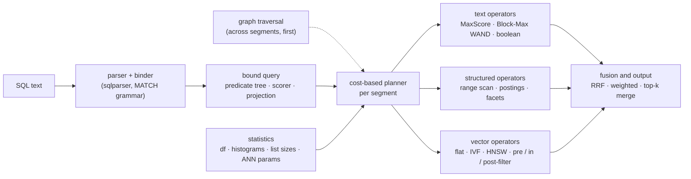
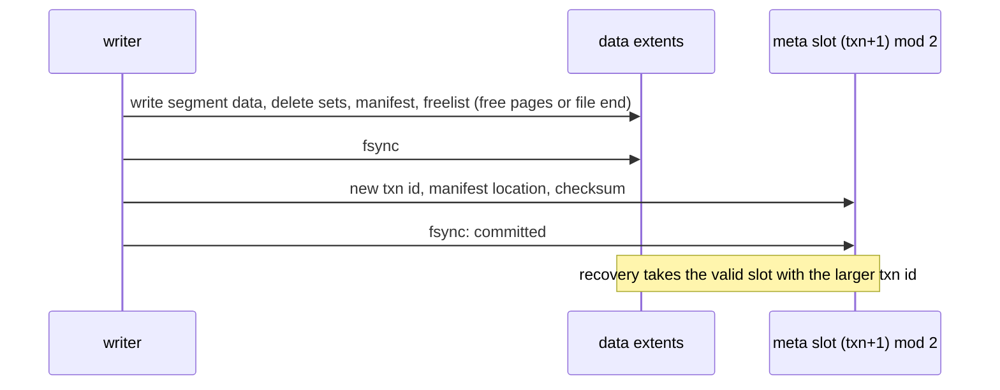

# Strata: design
{: .no_toc }

Strata is to search what SQLite is to relational data: a library that keeps a whole database in one file, needs no server or configuration, gives ACID transactions, and is queried with SQL. Every table is indexed three ways at once (posting lists, a columnar forward index and vector indexes), rows can hold graph edges to other rows, and a cost-based planner combines all of it in one statement.
{: .fs-5 .fw-300 }

1. TOC
{:toc}

## Goals

- **Embedded and single-file.** One `.strata` file plus a `-wal` sidecar, like SQLite in WAL mode. Opening a database maps the file and loads nothing eagerly, so databases larger than RAM work and a cold open costs the same whatever the size.
- **ACID with snapshot isolation.** One writer, any number of readers. Readers never block and always see a consistent snapshot; a crash at any point leaves the last committed state.
- **SQL with search extensions.** `SELECT … WHERE … ORDER BY … LIMIT`, `GROUP BY` for facets, plus `MATCH` (boolean full text), `bm25()`, `similarity()` and `distance()` (vectors), `rrf()` (rank fusion) and graph traversal. The [query language](query-language.md) page is the reference.
- **Three index families, freely combined.** Full text (BM25, boolean and phrase queries), structured fields (equality, `IN`, ranges, facets) and vectors (approximate and exact nearest neighbours), in any combination: filtered vector search, filtered BM25, hybrid ranking, facets over any result.
- **Graphs over the same rows.** A row can hold typed, weighted edges to other rows. Traversals, shortest paths and personalized PageRank run in the same statement as everything else ([Graphs](graphs.md)).
- **Disk-aware.** Every structure is read in place through `mmap`, with no deserialisation, and laid out so that a query's I/O is proportional to its work.

Joins, multiple writer processes and distribution are out of scope for the prototype.

## Architecture

A statement goes through four stages. The binder turns SQL into a predicate tree and a scorer; the planner picks, per segment and from exact statistics, how to evaluate each part; operators run against zero-copy views of the segment's sections; per-segment results are merged.

## Storage engine

### Immutable segments, not a B-tree

SQLite updates B-trees in place. Compressed posting lists, bit-packed columns and vector graphs do not survive that: inserting one docID into a compressed partition means re-encoding it, and the best encodings are chosen per whole list. SQLite's own FTS5 already stores its index as immutable segments merged in the background, as do Lucene, Tantivy and PISA. Strata uses that log-structured design for the whole table: every index lives in immutable segments, writes go to a WAL and an in-memory memtable, and segments are merged in the background.

### One file

Pages are 4 KiB. Pages 0 and 1 are two meta slots (magic, format version, transaction id, manifest and freelist locations, page count, CRC32C); the rest are extents, runs of pages holding segment data, manifests, delete sets and freelists. Segments are written once, never modified, and freed only when no snapshot references them.

The file is read through one `mmap`. Sections read at random positions (the HNSW graph and its codes, float32 vectors for re-ranking, dictionaries, the doc store, the key index) are advised `MADV_RANDOM`, so a cold page fault reads one page instead of the kernel's read-around of up to 32. Sections read a run at a time (postings, document lengths, columns, IVF clusters) keep read-ahead. Readers open lazily per field, so a query touches only the headers of the fields it uses.

### Commits by shadow paging

A torn meta write fails its checksum and the other slot still names the previous, fully written state. Nothing reachable from a valid meta slot is ever overwritten (the LMDB discipline), so there is no rollback journal.

### WAL, memtable and snapshots

Small transactions would otherwise write a segment each. Instead, inserts and deletes append checksummed records to the `-wal` sidecar and `fsync` at commit (group commit); recovery ignores uncommitted records. The memtable holds the WAL's documents. A snapshot that needs them builds small in-memory segments, one per chunk of 1,024 documents, cached so that a write rebuilds only the last chunk. Queries therefore see committed writes at once, and the memtable needs no index code of its own. With `publish_snapshots` on (Engram turns it on), the writer builds that chunk before the commit returns and readers only take the finished snapshot, so no reader builds one or waits for another reader's build. When it grows past a threshold it is flushed into a segment by a shadow-paging commit and the WAL is truncated. Bulk loads bypass the WAL.

Every document has a primary key. Each segment has a primary-key index (sorted 64-bit key hashes with docIDs) and a delete set, stored as its own small extent and replaced copy-on-write. An update is a delete plus an insert. A snapshot is an immutable manifest version (segments, their delete sets, collection statistics) held by reference count: readers pin one, the writer publishes the next. Taking one costs at most 0.13 µs.

### Merges

A tiered policy merges segments of similar size. A merge reads the live documents of its inputs back (stored fields from the doc store, vectors and unstored fields from their indexes, generated columns recomputed) and rebuilds every index, which drops deleted documents and re-optimises encodings for the longer lists. `vacuum` moves data down and shrinks the file.

## Segments

A segment is *n* documents with local docIDs `0..n`, stored as a header and a directory of named sections (`text.body.terms`, `text.body.post`, `col.year`, `vec.emb.ivf`, …). Sections are 64-byte aligned, and those over a page are page-aligned, so any `&[u64]` view of a section is aligned and an index can be used straight from the mapped file. Each index component has a builder (documents in docID order to section bytes) and a reader (sections to a zero-copy view). Operators run per segment and their results are merged; collection-wide statistics keep BM25 scores comparable across segments.

## Index families

### Full text

- **Analyzer.** Unicode word split, lowercase, ASCII folding, an English stopword list and a light English stemmer; queries use the same analyzer.
- **Term dictionary.** Sorted terms in front-coded blocks of 32, with a sparse in-memory index over block first-terms. Each entry gives the document frequency and the posting list's location.
- **Postings.** DocIDs, term frequencies and per-block maximum scores, so that top-k can skip blocks. DocIDs of terms in at least 512 documents are [Loom](../posting-lists.md#loom) lists; rarer terms use BP128 blocks. Frequencies are bit-packed in 128-posting blocks addressed by posting rank. Against BP128 for every list, Loom is 2–4% smaller with 7.6–11× faster conjunctions.
- **Top-k.** MaxScore by default; on the BEIR queries it beats Block-Max WAND by 1.9–2.6×. A filter either drives scoring (its members are scored directly) or is probed per candidate, by a fitted crossover.
- **Positions** (optional per field) live in a separate stream, read only by phrase queries.

Scores are BM25 with *k*1 = 1.2, *b* = 0.75 and Lucene's idf, over statistics summed across the snapshot's segments, so a document scores the same in any segment:

$$
\mathrm{bm25}(d, q) = \sum_{t \in q} \mathrm{idf}(t)\,\frac{\mathrm{tf}_{t,d}\,(k_1 + 1)}{\mathrm{tf}_{t,d} + k_1\bigl(1 - b + b\,\lvert d \rvert / \mathrm{avgdl}\bigr)},
\qquad
\mathrm{idf}(t) = \ln\Bigl(1 + \frac{N - \mathrm{df}_t + 0.5}{\mathrm{df}_t + 0.5}\Bigr)
$$

Document lengths are quantised to one byte. Ranked queries drop English function words and count each term once.

### Structured fields

- **Columns.** Integers and floats in 128-document blocks, frame-of-reference bit-packed, with min/max zone maps per block. Keywords are dictionary encoded with bit-packed codes. A column answers "value of document *d*" in O(1) and scans at memory bandwidth.
- **Keyword postings.** Every keyword value also gets a docID list, so equality and `IN` become set operations. The encoding is [Pyramid](../posting-lists.md#pyramid) (plain sorted arrays below 64 documents), which has the fastest unions and count-only intersections for facet counts. Per-candidate probes use the code column and a bitset of accepted codes (4–5 ns), which beats probing the lists (5–33 ns).
- **Range postings.** Numeric fields get an equi-depth histogram of 64 buckets whose buckets are docID lists. A range is the union of the buckets it covers, plus the boundary buckets filtered through the column. The histogram doubles as the selectivity estimator.
- **Doc store.** Rows in LZ4-compressed 16 KiB blocks with a block index; it serves projections and is the source for merges.
- **Generated columns.** A TEXT field may be generated from other stored text fields (`body` = title + text in the evaluation table), indexed but not stored, and recomputed by merges.

### Vectors

- **Forward vectors.** Every vector field stores float32 vectors for exact re-ranking and 8-bit scalar-quantised codes (SQ8, per-dimension min/max) for scanning: 4× less I/O, and with the query quantised too, integer dot products at about 14 ns per 1,024-dimension vector with NEON `usdot` on the M2 (AVX-512 VNNI on x86-64).
- **Flat.** An exact scan of the codes plus float32 re-ranking: the right answer for small segments and very selective filters.
- **IVF.** k-means centroids; each cluster's members are stored contiguously as a docID list followed by their codes. Probing a cluster is one sequential read, and a filter is applied by intersecting the cluster's list with the filter's, the same operation as a text conjunction.
- **HNSW.** A navigable small-world graph with fixed-degree adjacency lists in the segment. Fastest in memory; random I/O on disk.

### Graph edges

An `EDGES` field holds a row's outgoing edges as targets' primary keys, optionally with a label and a weight. Per segment, Strata stores the out-edges as a CSR over local docIDs and a reverse index grouped by target key; a hop resolves keys against the snapshot's primary-key indexes. Because edges point at keys and not at storage positions, they survive updates, deletes and merges untouched. The [Graphs](graphs.md) page covers the layout, the traversals and their cost.

## Planning and execution

The binder turns `WHERE` into a predicate tree over text leaves (`MATCH`), structured leaves (comparisons, `IN`, ranges) and graph leaves (`REACHABLE`, `PATH`), and turns `ORDER BY` into a scorer: BM25, vector, fusion, PageRank, a column, or none.

**Statistics.** Exact list lengths (document frequencies, keyword list sizes), histogram bucket counts, per-segment document counts and ANN parameters. Conjunctions assume independence; disjunctions use inclusion–exclusion.

**Filters: materialise or probe.** A predicate is either *materialised* (a docID set from postings) or *probed* (a per-candidate check against the forward column). Materialising costs work proportional to the lists; probing costs work proportional to the candidates. The planner materialises when the candidate stream is long relative to the lists and probes otherwise. Range filters also choose between a zone-map column scan and histogram bucket postings.

**Ranked retrieval.**

| `ORDER BY` | strategies |
|---|---|
| none or a column | iterate the filter; top-k heap or column sort |
| `bm25` | MaxScore or Block-Max WAND over postings, with the filter as a skip constraint |
| `similarity` | pre-filtered exact scan, IVF with in-filter intersection, HNSW with the filter inside, or post-filtering with oversampling |
| fusion | top-*k*′ from each input, union, exact re-scoring of every input on the union; or an exact scan |

### Filtered vector search

For a filter of estimated selectivity *s* over *n* rows and a top-*k* query, the strategies cost, in distance computations or their equivalent:

$$
C_{\text{pre}} \approx s\,n,
\qquad
C_{\text{IVF}} \propto \frac{\mathrm{nprobe}}{\sqrt{s}}\ \text{clusters},
\qquad
C_{\text{HNSW}} \propto \frac{1}{s}\ \text{times the unfiltered visits},
\qquad
C_{\text{post}} \approx \frac{k}{s}\ \text{candidates}
$$

What matters to the index strategies is the selectivity *near the query*, which differs from the global one whenever the filter correlates with the query's topic. When the global estimate picks an index strategy, the planner checks it with a 32-result unfiltered search: the smoothed fraction of those results that pass the filter replaces *s* for in-index search and bounds it from above for post-filtering. If that sample finds at most one match, a second, 160-neighbour sample follows. The [results](results.md#filtered-vector-search-and-the-planner) show what each refinement bought.

### Graphs, facets and segments

**Graphs** run before planning, across segments, because a traversal does not respect segment boundaries. Seeds are resolved (a seed subquery runs as its own query on the same snapshot), the traversal runs, and its result becomes per segment a materialised document set with exact cardinality, plus hop distances and PageRank scores. The planner then treats `REACHABLE` like any other filter, only with an exact estimate: a vector search over a reachable set of a few hundred rows becomes a pre-filtered exact scan.

**Facets.** `GROUP BY` a keyword either reads the dictionary codes of the result's documents (small results) or intersects the result with each value's Pyramid list, counting only (large results, few values).

**Segments.** Each segment runs the same physical plan with its own statistics, and per-segment top-k lists are merged.

The plan the planner chose is visible: the `strata` shell's `--plan` flag prints the executor's plan lines for each statement.

## Where it fits

Strata is built for embedded retrieval: local search over documents with metadata and embeddings, such as retrieval for a model on a laptop, a desktop app's search box or an edge device, with SQL and one file to copy, back up or ship. It suits read-mostly corpora with steady writes: commits are visible at once, and batching amortises their sync, but merges rebuild every index of the segments they combine, and HNSW builds dominate load time (IVF builds 2.1–2.5× faster for write-heavy vector workloads). It is not meant for relational workloads with joins, high write concurrency, or corpora larger than one machine.

**Current limits.** SQL covers single-table `SELECT`; writes go through the Rust API (`Database::begin`, `WriteTxn::insert`, `delete`, `commit`). The multi-process writer lock is designed but not built. Queries are single-threaded.

## Code layout

| path | what |
|---|---|
| `strata/src/storage/` | file format, meta slots and shadow-paging commits, WAL, memtable, snapshots, primary keys, merges, vacuum |
| `strata/src/segment/` | immutable segments of named, aligned sections, read zero-copy through `mmap` |
| `strata/src/text/` | analyser, Loom and BP128 postings, positions, BM25 with MaxScore and Block-Max WAND |
| `strata/src/forward/` | columns with zone maps, keyword dictionaries and Pyramid lists, range histograms, facets, doc store |
| `strata/src/vector/` | float32 and SQ8 vectors, flat, IVF and HNSW, filtered search |
| `strata/src/graph/` | EDGES fields: out-edge CSR and reverse index per segment; BFS, shortest paths, personalized PageRank |
| `strata/src/query/` | SQL binder, logical plan, cost-based planner, executor, fusion, graph predicates and scores |
| `strata/src/baselines/` | SQLite + FTS5 and Tantivy baselines (feature `baselines`) |
| `strata/src/bin/` | `strata` shell, `strata-eval`, component benchmarks, `strata-baselines`, `strata-graph-bench` |

The full design is in [`strata/DESIGN.md`](https://github.com/rkonow/engram/blob/main/strata/DESIGN.md), and the long-form report, with every chart and table, is [here](../reports/strata.html).
